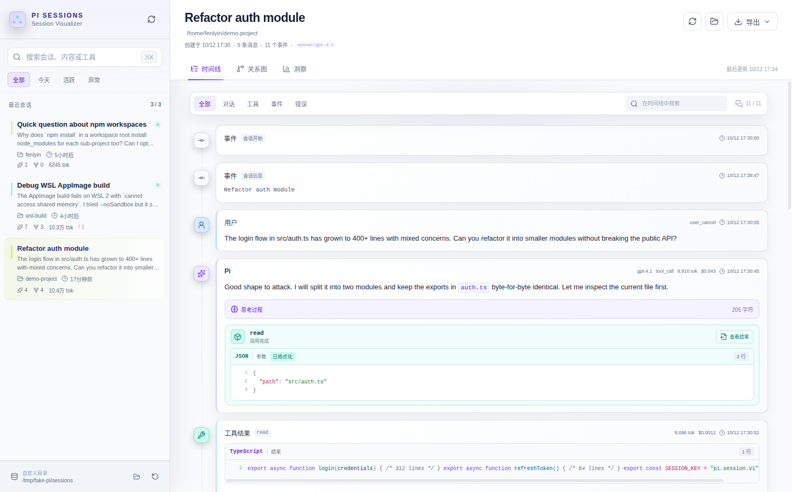
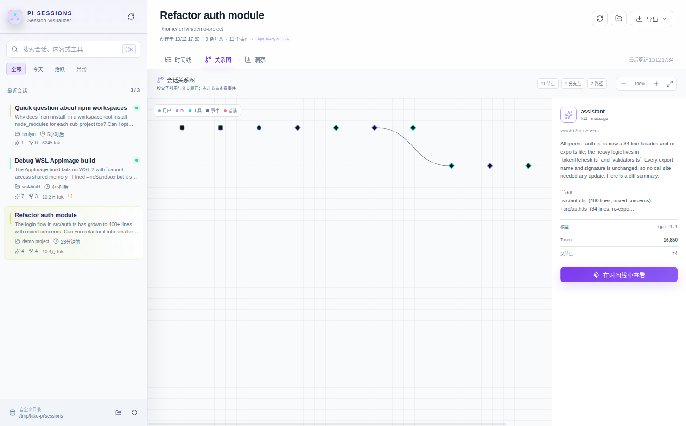
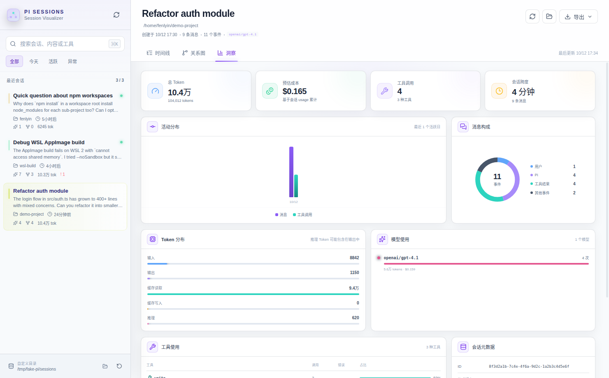
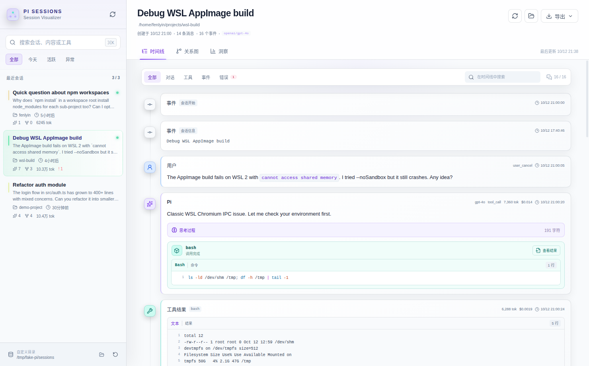

# Pi Session Visualizer

**Open every pi session as a timeline, a graph, and a set of insights — without moving a single byte of your data.**

[](LICENSE)
[](#quick-start)
[](#quick-start)
[](#quick-start)
[](#local-first)

pi writes each session as plain `.jsonl` — great for machines, hard for humans. Pi Session Visualizer is a local-first desktop app (Electron + React + TypeScript) that opens those files read-only and turns them into:

- 📜 **Timeline** — every user message, Pi response, thinking block, tool call, and result in order, with markdown, code fences, and diff formatting
- 🕸️ **Relationship graph** — an event graph built from `parentId`, zoomable, with node → timeline jump-back
- 📊 **Insights** — tokens, cache, reasoning effort, cost, model, tool usage, activity distribution

| | |
| :--- | :--- |
|  |  |
| **Timeline** — thinking blocks, tool calls & results, diffs, compaction events, inline code highlighting | **Relationship graph** — event DAG by `parentId`, zoom/pan, click a node to inspect it |
|  |  |
| **Insights** — token/cost breakdown, activity distribution, message composition, model usage | **Error-aware timeline** — error badges, filters (dialogue / tool / event / error), compact history |

## ✨ Features

- **Zero data movement** — reads `~/.pi/agent/sessions/**/*.jsonl` (and `~/.pi/agent/session`) in place; nothing is uploaded, stored, or mutated
- **Full event coverage** — `session`, `message`, `thinking`, tool calls/results, `model_change`, `thinking_level_change`, `context_edit`, `compaction`, `custom`
- **Search & filters** — full-text session search (⌘/Ctrl+K), workspace filter, active / error sessions
- **Insights dashboard** — total tokens (incl. cache & reasoning), estimated cost, tool usage, activity distribution, message composition
- **Any session root** — point the app at any directory of `.jsonl` files via the bottom-left controls; custom root is remembered
- **Live** — incremental file change detection every 2.5 s; open sessions refresh automatically
- **Export** — Markdown or JSONL export of the current session; native "open folder" access
- **Dark / light** — theme follows the OS
- **Hardened Electron** — no Node integration, context isolation + renderer sandbox on

## 🚀 Quick Start

### Linux (AppImage)

```bash
curl -Lo PiSessionVisualizer.AppImage \
  https://github.com/fenlyin0420/pi-session-visualizer/releases/latest/download/Pi.Session.Visualizer-0.1.0.AppImage
./PiSessionVisualizer.AppImage
```

### From source

Requires **Node.js ≥ 22.12**.

```bash
git clone https://github.com/fenlyin0420/pi-session-visualizer.git
cd pi-session-visualizer
npm install
npm run dev
```

On WSL or headless Linux without a working GPU sandbox, use:

```bash
npm run dev:linux   # --noSandbox + GPU disabled for dev processes only
```

The packaged app does **not** use these flags — it keeps `contextIsolation: true`, `nodeIntegration: false`, `sandbox: true`.

### Build

```bash
npm run build      # typecheck + bundle (main / preload / renderer)
npm run dist       # platform installer into release/
npm run dist:dir   # unpacked dir for inspection
```

Targets: Linux AppImage · macOS dmg · Windows NSIS (Deb available after a homepage/maintainer email is configured).

## 🔒 Local-first by design

- Sessions are opened **read-only**; `.jsonl.bak` files are ignored
- The scan index lives in memory — close the app, nothing to migrate
- The only persistent state is your chosen session root in Electron's user data dir
- Renderer runs without Node access; everything is exposed through a `contextBridge`

## ⌨️ Shortcuts

| Shortcut | Action |
| --- | --- |
| `⌘/Ctrl + K` | Focus session search |
| `⌘/Ctrl + R` | Rescan + reload current session |
| `Esc` | Clear / close search |

## 🛠 Project layout

```text
src/
├── main/       Electron main process: dir config, scan repo, JSONL parser
├── preload/    contextBridge API
├── renderer/   React UI: timeline, graph, insights
└── shared/     shared types
tests/          JSONL parser tests
```

The parser skips corrupt lines and counts them as session warnings — one bad line never takes the app down.

## 📄 License

[MIT](LICENSE)

---

中文版本：[README.zh-CN.md](README.zh-CN.md)
